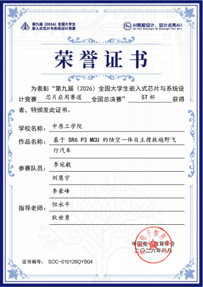
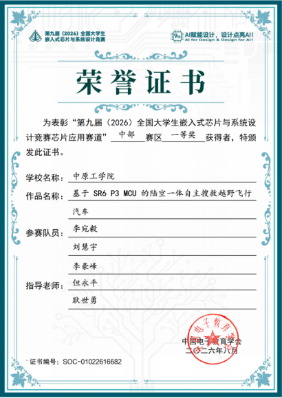

# 第 9 届全国大学生嵌入式芯片与系统设计竞赛：ST 杯获奖作品半开源

   

本作品为基于 SR6P3C4 的空地两栖越野飞行汽车，获第九届全国大学生嵌入式芯片与系统设计竞赛国家一等奖及 ST 杯。这里是整套项目的母仓库，硬件工程、代码、文档都从这里开始找。

---

## 赛题与实现功能

- [2026 应用赛道 — 意法半导体赛题（选题指南）](http://www.nationalcompetition.com.cn/)
- [嵌入式芯片与系统设计竞赛官网](http://www.nationalcompetition.com.cn/)

本项目大致实现的功能：基于指定 MCU 进行飞控与车控开发，实现空地两栖模式切换、GPS 自主巡航导航、手动遥控与自动巡航双工作模式，适配多路况野外作业场景。

---

## 作品简介

本作品为基于 **SR6P3C4** 的陆空一体自主搜救越野飞行汽车，实现遥控手动与 GPS 自主巡航双工作模式，支持地面行驶与空中飞行自由切换，适配多路况野外作业场景。

- **手动模式**：车与无人机自由切换行驶，操作人员通过遥控器直接控制
- **自动模式**：GPS 航点打点、自主路径巡航，根据航点工况自动切换地面/飞行
- **硬件架构**：三核异构架构，0 核处理主控控制、1 核遥控解析、2 核 GPS 定位数据，核间采用轮询通信
- **飞控方案**：团队自研飞控

**运行演示视频**：[B站：飞行汽车项目运行](https://b23.tv/ndmnykf)

---

## 获奖证书

---

## 项目难点

1. **车与飞机切换**：涉及大量标志位设置与通信数据一致性保障，曾出现来回切换后遥控失效、导航中断等问题，最终通过梳理状态机逻辑与修正遥控数据解析解决。

2. **机械结构与重心**：飞行汽车重量需四周均匀分布，否则飞控参数难以整定；中间连接部位松动会导致飞控持续抖动，初期曾误判为算法或陀螺仪问题。

3. **动力系统选型**：受整机重量约束，电机、电调与桨叶的匹配选型耗费较长时间，需在推力、重量与续航之间取得平衡。

4. **系统稳定性**：曾出现芯片莫名卡死、烧录耗时长等问题，通过精简屏幕显示、停止非必要功能缓解。

5. **三核资源调度**：三个核心的资源协调与核间通信是系统设计重点，采用轮询共享内存方式避免中断抢占。

---

## 材料清单

| 物品 | 型号 | 预估费用 |
|---|---|---|
| 核心板 | SR6P3C4 | 400 元 |
| 舵机 | MG996R | 12 元 |
| GPS 模块＋天线 | 逐飞 GPS 模块套件 | 210 元 |
| 无线串口（一对） | 逐飞无线串口模块 | 85 元 |
| 陀螺仪 | IMU660RA | 45 元 |
| 遥控器 | 富斯 i6X 航模遥控器 | 175 元 |
| 遥控器接收机 | FS-IA6B | 60 元 |
| 显示屏 | IPS200 液晶显示屏 | 20 元 |
| 机架带机臂 | 穿越机类型 | 100 元 |
| 保护罩 | F330/F450 正反桨保护罩 | 12 元 |
| 桨叶 | HQProp 7040 七寸三叶桨 | 17 元 |
| 分体电调 ×4 | 小蜜蜂 BLHeli-S | 128 元 |
| 电机 ×4 | 好盈 XRotor 乐天 2807 | 232 元 |
| 电池 | 格式 4000mAh 4S 30C | 290 元 |

> 其余硬件电路板及 3D 打印拼接板未计入，加上各类工具后整体预算约 **2000 元以内**，部分器件可平替或采购二手。

---

## 开源说明

本作品为**半开源方案**：

- **硬件已全部开源**，立创 EDA 工程文件见 `Fly_Car_project_硬件开源部分/`
- **代码公开主要逻辑框架**，完整工程受实验室相关约定限制暂不便全部放出，望见谅
- 一般底层配置大多可以通过 AI 辅助完成
- 大题思路与算法网上肯定也有更好的方案，这里主要是提供一个完整项目的思路参考
- 算法或逻辑类问题欢迎提交 [Issue](../../issues) 交流

---

## 感谢一路同行的所有人

能走到今天这一步，要感谢的人太多。

感谢学校和学院在备赛期间提供的场地与经费支持，感谢指导老师们从赛题分析到方案落地一路的悉心点拨，也感谢实验室学长学姐们当初毫无保留地把经验传给我们。

特别感谢我的队友们，三个多月泡在实验室里一起熬夜、一起调试、一起在赛场等成绩，那种互相补位、互相打气的日子，是这次比赛最珍贵的收获。

也要感谢一路上在赛场交流过的其他学校的朋友们，每次讨论都能打开新思路。比赛既是竞争，也是互相学习的过程。

---

## 交流与支持

本项目主要为想实现飞行汽车类作品的同学提供思路参考。硬件已全部开源，底层配置借助 AI 即可完成搭建。如果遇到算法或逻辑层面的问题，欢迎提交 Issue 交流。

如果本项目对你有帮助，欢迎点一颗 ⭐ Star！
